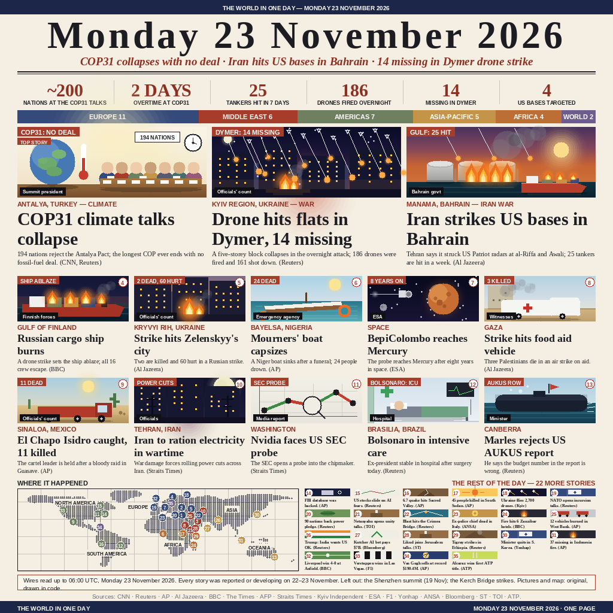

# Monday 23 November 2026 — The World in One Day

[](https://make.fun/bounty/news-image-20261123)
[](https://make.fun/bounty/news-image-20261123)
[](https://make.fun/bounty/news-image-20261123)

A one-page newspaper front page summing up **Monday 23 November 2026** in a
single 1024×1024 image — 35 dated stories, 6 regions, one dotted world map
with 35 numbered pins, a stat strip, a region bar and a DATE CHECK box.
Pure Python standard library; the picture is drawn in code (flat vector,
zero photos) and the type is the real Liberation typeface, rendered from
glyph atlases built at build time.



## How to run

```sh
python3 main.py            # writes out/entry.png (MAKEFUN_OUTPUT_DIR)
```

Deterministic: two runs — including a clean-room `env -i` run — write
byte-identical PNGs (sha256 `d254ddbd…`). No network, no randomness, no
clock. The build fails loudly on any split word, overflow, orphaned source
tag, or off-grid section (see `audit()` in `main.py`).

## What is on the page

- **3 heroes** — COP31 collapses in Antalya · drone hits flats in Dymer,
  14 missing · Iran strikes US bases in Bahrain (25 tankers hit in a week).
- **10 mid stories** — Gulf of Finland ship ablaze · Kryvyi Rih strike ·
  Bayelsa boat capsizes · BepiColombo reaches Mercury · Gaza aid vehicle ·
  El Chapo Isidro caught · Tehran power rationing · Nvidia SEC probe ·
  Bolsonaro in intensive care · Marles rejects the US AUKUS report.
- **22 more stories** in the bottom grid, each with its own tiny scene.
- **Map** — hand-drawn continent polygons rasterised to a dot grid,
  graticule every 30°, 35 numbered pins (decluttered with leader lines).
- **DATE CHECK** — wires read up to 06:00 UTC, 23 November 2026; every
  story was reported or developing on 22–23 November.

## Files

| file | what it is |
| --- | --- |
| `main.py` | the whole page: PNG codec, font engine, wrap + audits, scenes, map, layout |
| `gen_fonts.py` | builds the Liberation glyph atlases (`atlas_*.png` + `.meta`) |
| `gen_map.py` | rasterises the hand-written continent polygons to `worldmap.txt` |
| `atlas_*.png` / `.meta` | glyph sheets + metrics (zlib+base64 JSON) |
| `worldmap.txt` | land-cell bitmask, 140×72 |
| `entry.png` | the rendered front page |
| `FONT_LICENSES.md` | Liberation fonts are under the SIL OFL 1.1 |

## Sources

CNN · Reuters · AP · Al Jazeera · BBC · The Times · AFP · Straits Times ·
Kyiv Independent · ESA · F1 · Yonhap · ANSA · Bloomberg · ST · TOI · ATP.
